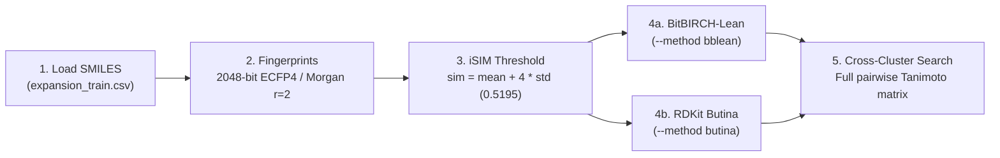

# BitBIRCH-Lean (`bblean`) vs. RDKit Butina Clustering & Cross-Cluster Similarity Analysis

This repository demonstrates a reproducible workflow for clustering a molecular dataset (`expansion_train.csv`, 5,326 structures) using both [**BitBIRCH-Lean (`bblean`)**](https://github.com/mqcomplab/bblean) and **RDKit Taylor-Butina (`rdkit.ML.Cluster.Butina`)** clustering, then identifying the most similar compound pairs that end up in **different** clusters under each algorithm.

---

## Repository Contents

| File | Description |
| :--- | :--- |
| `expansion_train.csv` | Input dataset containing **5,326** molecules (`Molecule Name`, `SMILES`, and ADME assay columns). |
| `bblean_cluster.py` | Reusable Python module wrapping `bblean.BitBirch` following the [BitBIRCH Best Practices notebook](https://github.com/mqcomplab/bblean/blob/main/examples/bitbirch_best_practices.ipynb). |
| `butina_cluster.py` | Reusable Python module wrapping `rdkit.ML.Cluster.Butina.ClusterData` using the same 2048-bit Morgan (`radius=2`) fingerprints and iSIM-estimated similarity threshold. |
| `find_cross_cluster_similar.py` | End-to-end CLI script (`--method bblean` or `--method butina`) that runs the selected clustering algorithm, writes the clustered dataset, computes the full pairwise Tanimoto similarity matrix, and exports the most similar cross-cluster pairs. |
| `expansion_train_clustered.csv` | Generated output dataset with 1-indexed **BitBIRCH** `cluster` assignments appended (`679` clusters total). |
| `similar_compounds_different_clusters.csv` | Generated table of all **709** cross-cluster molecule pairs (Tanimoto $\ge 0.80$) from **BitBIRCH** clustering. |
| `expansion_train_butina_clustered.csv` | Generated output dataset with 1-indexed **RDKit Butina** `cluster` assignments appended (`507` clusters total). |
| `similar_compounds_different_clusters_butina.csv` | Generated table of all **401** cross-cluster molecule pairs (Tanimoto $\ge 0.80$) from **RDKit Butina** clustering. |

---

## Workflow Overview

The end-to-end workflow executed by `find_cross_cluster_similar.py` proceeds in four main stages:



### Step 1: Fingerprint Generation
Each SMILES string is converted into a 2048-bit Morgan/ECFP4 fingerprint (`radius=2`, `fpSize=2048`) via RDKit's `GetMorganGenerator(radius=2, fpSize=2048)`.

### Step 2: Data-Driven Similarity Threshold Estimation (iSIM)
Rather than hardcoding an arbitrary Tanimoto cutoff, both methods estimate the dataset's baseline similarity distribution using instant similarity (**iSIM**):
1. Computes the exact average pairwise Tanimoto similarity ($\mu \approx 0.1705$) across all 5,326 fingerprints in $O(N)$ time via `bblean.similarity.jt_isim_packed`.
2. Selects 50 stratified representative molecules via `bblean.similarity.jt_stratified_sampling` and computes their pairwise Tanimoto standard deviation ($\sigma \approx 0.0873$).
3. Sets the Tanimoto similarity threshold to:
   $$\text{similarity threshold} = \mu + 4\sigma \approx 0.5195 \quad (\text{Butina distance threshold} = 1 - 0.5195 = 0.4805)$$

### Step 3: Clustering (`bblean` vs. `butina`)
- **BitBIRCH-Lean (`--method bblean`):**
  - Fits an $O(N)$ `bblean.BitBirch(branching_factor=50, threshold=0.5195, merge_criterion="diameter")` tree (719 initial clusters, 228 singletons).
  - Refines clusters via `bb_tree.recluster_inplace(iterations=5, extra_threshold=std)` down to **679 final clusters** (191 singletons).
- **RDKit Taylor-Butina (`--method butina`):**
  - Computes the $O(N^2)$ lower-triangular Tanimoto distance vector (`13,658,525` pairs) using `DataStructs.BulkTanimotoSimilarity`.
  - Runs `Butina.ClusterData(dists, n_mols, distThresh=0.4805, isDistData=True, reordering=True)`, producing **507 final clusters** (187 singletons).

### Step 4: Pairwise Cross-Cluster Tanimoto Analysis
1. The full $5326 \times 5326$ Tanimoto similarity matrix is computed on the packed fingerprints using `bblean.similarity.jt_sim_matrix_packed(fps)`.
2. All self-pairs, lower-triangular duplicates, and pairs belonging to the **same** cluster (`cluster_i == cluster_j`) are masked out.
3. All cross-cluster pairs with Tanimoto similarity $\ge 0.80$ are sorted in descending order, annotated for whether they differ solely by stereochemistry (`Is_Stereoisomer_Pair`), and saved to CSV.

---

## Installation & Requirements

Requires Python 3.10+ with `bblean` ($\ge 0.14.0$), `rdkit`, `pandas`, and `numpy`:

```bash
pip install "bblean>=0.14.0" rdkit pandas numpy
```

---

## Usage

### 1. Run BitBIRCH-Lean Clustering (Default)

```bash
python find_cross_cluster_similar.py --method bblean --verbose
```

### 2. Run RDKit Taylor-Butina Clustering

```bash
# Using the same iSIM-estimated threshold (dist_thresh = 0.4805 / sim = 0.5195)
python find_cross_cluster_similar.py --method butina --verbose

# Or specify a custom Butina Tanimoto distance cutoff (e.g., 0.35 -> similarity >= 0.65)
python find_cross_cluster_similar.py --method butina --butina-dist-thresh 0.35 --verbose
```

---

## Comparison of Results: BitBIRCH-Lean vs. RDKit Butina

| Metric | BitBIRCH-Lean (`bblean`) | RDKit Taylor-Butina (`butina`) |
| :--- | :--- | :--- |
| **Algorithmic Complexity** | $O(N)$ online tree construction | $O(N^2)$ full pairwise distance matrix |
| **Similarity Threshold** | `0.5195` (initial diameter) | `0.5195` (`distThresh = 0.4805` radial sphere) |
| **Total Clusters** | **679** | **507** |
| **Singletons** | **191** | **187** |
| **Top 5 Cluster Sizes** | 270, 164, 114, 105, 104 | 403, 367, 249, 232, 166 |
| **Cross-Cluster Pairs with `Tanimoto = 1.0000`** | **17 pairs** (16 stereoisomer pairs + 1 ring-size homolog) | **0 pairs** |
| **Maximum Cross-Cluster Tanimoto Similarity** | **1.0000** (`0.9808` for non-identical fingerprints) | **0.9808** |
| **Cross-Cluster Pairs with `Tanimoto >= 0.80`** | **709 pairs** | **401 pairs** |

### Why BitBIRCH-Lean and RDKit Butina Behave Differently on `Tanimoto = 1.0` Pairs
- **Why RDKit Butina has `0` cross-cluster pairs with `Tanimoto = 1.0000`:**
  In Taylor-Butina clustering, every molecule has an exact neighbor list of all molecules within `distThresh`. Any two molecules $A$ and $B$ with identical fingerprints (`distance = 0.0`) have identical neighbor sets. The first time either $A$, $B$, or any neighbor within `distThresh` is chosen as a cluster centroid, **both** $A$ and $B$ are guaranteed to lie at the exact same distance from that centroid and are swept into the same cluster simultaneously.
- **Why BitBIRCH-Lean has `17` cross-cluster pairs with `Tanimoto = 1.0000`:**
  BitBIRCH inserts molecules sequentially into a tree and checks whether adding a molecule to an existing leaf cluster keeps the cluster's **diameter** above the threshold. If molecule $A$ enters a cluster early and subsequent molecules shift that cluster's bit-sum/diameter toward another region of chemical space, a later molecule $B$ with the exact same fingerprint as $A$ can fail the diameter merge check against $A$'s expanded cluster and be routed to a different branch.

### Top 10 Cross-Cluster Similar Pairs in RDKit Butina (`distThresh = 0.4805`)

Even though Butina never separates identical fingerprints (`Tanimoto = 1.0`), it still splits highly similar constitutional homologs (`Tanimoto = 0.90–0.98`) whenever one member lies inside a larger cluster centroid's capture radius (`<= 0.4805`) while its close analog falls just outside (`> 0.4805`):

| Rank | Tanimoto | Molecule 1 (Cluster, Size) | Molecule 2 (Cluster, Size) | Structural Difference | SMILES 1 / SMILES 2 |
| :--- | :--- | :--- | :--- | :--- | :--- |
| **1** | **0.9808** | **E-0017502** (Cluster 2, *n*=367) | **E-0018911** (Cluster 15, *n*=77) | Piperidine vs. Pyrrolidine ring | `Cc1cc(-c2ccc(OCCN3CCCCC3)c(C)c2O)c2ccncc2c1`<br>`Cc1cc(-c2ccc(OCCN3CCCC3)c(C)c2O)c2ccncc2c1` |
| **2** | **0.9773** | **E-0016988** (Cluster 42, *n*=22) | **E-0019371** (Cluster 77, *n*=12) | Piperidine vs. Pyrrolidine ring | `c1cc(-c2csc3cncn23)ccc1OCCN1CCCCC1`<br>`c1cc(-c2csc3cncn23)ccc1OCCN1CCCC1` |
| **3** | **0.9412** | **E-0010519** (Cluster 48, *n*=19) | **E-0010520** (Cluster 318, *n*=2) | Propyl vs. Ethyl amide linker | `CN(C)CCCNC(=O)c1cc2c3cc(OCCCN(C)C)ccc3n(C)c2cn1`<br>`CN(C)CCCOc1ccc2c(c1)c1cc(C(=O)NCCN(C)C)ncc1n2C` |
| **4** | **0.9333** | **E-0011699** (Cluster 9, *n*=99) | **E-0013853** (Cluster 2, *n*=367) | Isoquinoline vs. Quinoline core isomer | `c1cc(OCCN2CCCCC2)cc(-c2ccc3ccncc3c2)c1`<br>`c1cc(OCCN2CCCCC2)cc(-c2ccc3cnccc3c2)c1` |
| **5** | **0.9298** | **E-0020046** (Cluster 1, *n*=403) | **E-0020098** (Cluster 86, *n*=11) | Piperazine vs. Homopiperazine ring | `Cc1nnc(-c2ccc3c(c2)cc(C(=O)N2CCN(c4ccncc4)CC2)n3C)s1`<br>`Cc1nnc(-c2ccc3c(c2)cc(C(=O)N2CCCN(c4ccncc4)CC2)n3C)s1` |
| **6** | **0.9273** | **E-0010358** (Cluster 14, *n*=84) | **E-0010362** (Cluster 9, *n*=99) | Propoxy vs. Ethoxy morpholine linker | `Cc1c2ccncc2cc2c3cc(OCCCN4CCOCC4)ccc3n(C)c12`<br>`Cc1c2ccncc2cc2c3cc(OCCN4CCOCC4)ccc3n(C)c12` |
| **7** | **0.9149** | **E-0017121** (Cluster 367, *n*=1) | **E-0017185** (Cluster 26, *n*=42) | Homopiperazine vs. Piperazine ring | `Cc1cn(C)c(=O)c2[nH]c3cc(N4CCCNCC4)ccc3c12`<br>`Cc1cn(C)c(=O)c2[nH]c3cc(N4CCNCC4)ccc3c12` |
| **8** | **0.9032** | **E-0017065** (Cluster 1, *n*=403) | **E-0017821** (Cluster 3, *n*=249) | 4-Aminopiperidine vs. 3-Aminopyrrolidine | `Cc1nnc(-c2ccc3cc(C(=O)NC4CCN(c5ccncc5)CC4)nn3c2)s1`<br>`Cc1nnc(-c2ccc3cc(C(=O)N[C@H]4CCN(c5ccncc5)C4)nn3c2)s1` |
| **9** | **0.9032** | **E-0017065** (Cluster 1, *n*=403) | **E-0017869** (Cluster 3, *n*=249) | 4-Aminopiperidine vs. 3-Aminopyrrolidine | `Cc1nnc(-c2ccc3cc(C(=O)NC4CCN(c5ccncc5)CC4)nn3c2)s1`<br>`Cc1nnc(-c2ccc3cc(C(=O)N[C@@H]4CCN(c5ccncc5)C4)nn3c2)s1` |
| **10** | **0.9020** | **E-0017202** (Cluster 8, *n*=105) | **E-0017204** (Cluster 26, *n*=42) | 3-Pyrrolidinyloxy vs. 3-Piperidinyloxy | `Cc1cn(C)c(=O)c2[nH]c3cc(O[C@@H]4CCN(C)C4)ccc3c12`<br>`Cc1cn(C)c(=O)c2[nH]c3cc(O[C@H]4CCCN(C)C4)ccc3c12` |
