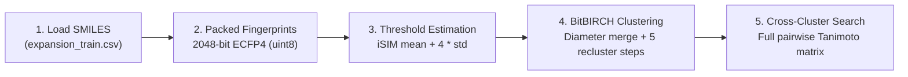

# BitBIRCH-Lean (`bblean`) Molecular Clustering & Cross-Cluster Similarity Analysis

This repository demonstrates a reproducible workflow for clustering a molecular dataset (`expansion_train.csv`, 5,326 structures) using [**BitBIRCH-Lean (`bblean`)**](https://github.com/mqcomplab/bblean) and identifying the most similar compound pairs that end up in **different** clusters.

---

## Repository Contents

| File | Description |
| :--- | :--- |
| `expansion_train.csv` | Input dataset containing **5,326** molecules (`Molecule Name`, `SMILES`, and ADME assay columns). |
| `bblean_cluster.py` | Reusable Python module wrapping `bblean.BitBirch` following the [BitBIRCH Best Practices notebook](https://github.com/mqcomplab/bblean/blob/main/examples/bitbirch_best_practices.ipynb). |
| `find_cross_cluster_similar.py` | End-to-end CLI script that runs the clustering workflow, writes the clustered dataset, computes the full pairwise Tanimoto similarity matrix, and exports the most similar cross-cluster pairs. |
| `expansion_train_clustered.csv` | Generated output dataset with 1-indexed BitBIRCH `cluster` assignments appended (`679` clusters total). |
| `similar_compounds_different_clusters.csv` | Generated table of all **709** cross-cluster molecule pairs with Tanimoto similarity $\ge 0.80$, sorted in descending order of similarity. |

---

## Workflow Overview

The end-to-end workflow executed by `find_cross_cluster_similar.py` proceeds in five steps:



### Step 1: Packed Fingerprint Generation
Each SMILES string is converted into a packed 2048-bit Morgan/ECFP4 fingerprint (`uint8` array of shape `(N, 256)`) using `bblean.fps_from_smiles(..., pack=True, n_features=2048, kind="ecfp4")`.

### Step 2: Data-Driven Similarity Threshold Estimation
Rather than hardcoding a Tanimoto cutoff, `bblean_cluster` estimates the dataset's baseline similarity distribution using instant similarity (**iSIM**):
1. Computes the exact average pairwise Tanimoto similarity ($\mu \approx 0.1705$) across all 5,326 fingerprints in $O(N)$ time via `bblean.similarity.jt_isim_packed`.
2. Selects 50 stratified representative molecules via `bblean.similarity.jt_stratified_sampling` and computes their pairwise Tanimoto standard deviation ($\sigma \approx 0.0873$).
3. Sets the initial BitBIRCH threshold to:
   $$\text{threshold} = \mu + 4\sigma \approx 0.5195$$

### Step 3: BitBIRCH Tree Construction & Reclustering
1. A `bblean.BitBirch(branching_factor=50, threshold=optimal_threshold, merge_criterion="diameter")` tree is fitted to the packed fingerprints (producing 719 initial clusters, including 228 singletons).
2. `bb_tree.recluster_inplace(iterations=5, extra_threshold=std)` refines the leaf clusters by re-inserting subclusters while incrementing the threshold by $\sigma$, consolidating clusters down to **679 final clusters** (191 singletons).
3. Cluster IDs (`1` to `679`, ordered from largest cluster to smallest) are retrieved via `bb_tree.get_assignments()` and saved to `expansion_train_clustered.csv`.

### Step 4: Pairwise Cross-Cluster Tanimoto Analysis
1. The full $5326 \times 5326$ Tanimoto similarity matrix is computed on the packed fingerprints using `bblean.similarity.jt_sim_matrix_packed(fps)`.
2. All self-pairs, lower-triangular duplicates, and pairs belonging to the **same** cluster (`cluster_i == cluster_j`) are masked out.
3. All cross-cluster pairs with Tanimoto similarity $\ge 0.80$ are sorted in descending order, annotated for whether they differ solely by stereochemistry (`Is_Stereoisomer_Pair`), and saved to `similar_compounds_different_clusters.csv`.

---

## Installation & Requirements

Requires Python 3.10+ with `bblean` ($\ge 0.14.0$), `rdkit`, `pandas`, and `numpy`:

```bash
pip install "bblean>=0.14.0" rdkit pandas numpy
```

---

## Usage

### Run the Complete Pipeline

```bash
python find_cross_cluster_similar.py --verbose
```

### Command-Line Options

```text
usage: find_cross_cluster_similar.py [-h] [--input INPUT] [--smiles-col SMILES_COL]
                                     [--name-col NAME_COL]
                                     [--clustered-output CLUSTERED_OUTPUT]
                                     [--pairs-output PAIRS_OUTPUT]
                                     [--min-sim MIN_SIM] [--fp-kind FP_KIND]
                                     [--n-features N_FEATURES] [--verbose]

options:
  --input INPUT                        Path to input CSV file (default: expansion_train.csv)
  --smiles-col SMILES_COL              Name of the SMILES column (default: SMILES)
  --name-col NAME_COL                  Name of the molecule identifier column (default: 'Molecule Name')
  --clustered-output CLUSTERED_OUTPUT  Path to save the clustered dataset CSV (default: expansion_train_clustered.csv)
  --pairs-output PAIRS_OUTPUT          Path to save cross-cluster similar pairs CSV (default: similar_compounds_different_clusters.csv)
  --min-sim MIN_SIM                    Minimum Tanimoto similarity threshold for saving cross-cluster pairs (default: 0.80)
  --fp-kind FP_KIND                    Fingerprint kind for bblean (default: ecfp4)
  --n-features N_FEATURES              Number of fingerprint bits (default: 2048)
  --verbose                            Print detailed BitBIRCH reclustering progress
```

### Use `bblean_cluster` in Python

```python
import pandas as pd
from bblean_cluster import bblean_cluster

df = pd.read_csv("expansion_train.csv")
cluster_ids, bb_tree = bblean_cluster(df, smiles_column="SMILES", verbose=True)
df["cluster"] = cluster_ids
```

---

## Key Results

### 1. Cluster Size Distribution
- **Total molecules:** 5,326
- **Total clusters:** 679 (191 singletons)
- **Top 5 largest clusters:**
  - Cluster 1: 270 molecules
  - Cluster 2: 164 molecules
  - Cluster 3: 114 molecules
  - Cluster 4: 105 molecules
  - Cluster 5: 104 molecules

### 2. Why Cross-Cluster Pairs Can Have `Tanimoto = 1.0000`
There are **17 cross-cluster pairs** with an exact Tanimoto similarity of `1.0000`:
- **16 of the 17 pairs** are **stereoisomers** (enantiomers or diastereomers). Because standard 2D `ecfp4` fingerprints are achiral, stereoisomers produce identical bit vectors (`Tanimoto = 1.0`).
- **1 of the 17 pairs** (`E-0014489` in Cluster 41 vs. `E-0015468` in Cluster 7) is a **constitutional ring-size homolog** (piperidine vs. azepane ring) whose radius-2 atomic neighborhoods hash to the same 2048-bit ECFP4 vector.
- Because BitBIRCH is an online, order-dependent tree construction algorithm using a strict diameter merge criterion, two identical fingerprints inserted at different points can be absorbed into different subclusters whose existing members prevent the two subclusters from merging without violating the diameter threshold.

### 3. Top Non-Identical Constitutional Cross-Cluster Pairs (`Tanimoto < 1.0000`)

| Rank | Tanimoto | Molecule 1 (Cluster, Size) | Molecule 2 (Cluster, Size) | Structural Difference | SMILES 1 / SMILES 2 |
| :--- | :--- | :--- | :--- | :--- | :--- |
| **18** | **0.9808** | **E-0015212** (Cluster 7, *n*=82) | **E-0017720** (Cluster 14, *n*=61) | Piperidine vs. Pyrrolidine ring | `CNc1c(-c2ccc(OCCN3CCCCC3)cc2)cc2cnccc2c1C`<br>`CNc1c(-c2ccc(OCCN3CCCC3)cc2)cc2cnccc2c1C` |
| **19** | **0.9804** | **E-0011306** (Cluster 28, *n*=38) | **E-0013790** (Cluster 44, *n*=27) | Pyrrolidine vs. Piperidine ring | `COc1cncc(-c2cn(C)c3ccc(OCCCN4CCCC4)cc23)c1`<br>`COc1cncc(-c2cn(C)c3ccc(OCCCN4CCCCC4)cc23)c1` |
| **20** | **0.9800** | **E-0015468** (Cluster 7, *n*=82) | **E-0015904** (Cluster 5, *n*=104) | Azepane vs. Pyrrolidine ring | `Cc1c(N)c(-c2ccc(OCCN3CCCCCC3)cc2)cc2cnccc12`<br>`Cc1c(N)c(-c2ccc(OCCN3CCCC3)cc2)cc2cnccc12` |
| **21** | **0.9800** | **E-0014489** (Cluster 41, *n*=28) | **E-0015904** (Cluster 5, *n*=104) | Piperidine vs. Pyrrolidine ring | `Cc1c(N)c(-c2ccc(OCCN3CCCCC3)cc2)cc2cnccc12`<br>`Cc1c(N)c(-c2ccc(OCCN3CCCC3)cc2)cc2cnccc12` |
| **22** | **0.9792** | **E-0013846** (Cluster 41, *n*=28) | **E-0016027** (Cluster 14, *n*=61) | Piperidine vs. Pyrrolidine ring | `CNc1cc2ccncc2cc1-c1ccc(OCCN2CCCCC2)cc1`<br>`CNc1cc2ccncc2cc1-c1ccc(OCCN2CCCC2)cc1` |
| **23** | **0.9756** | **E-0011648** (Cluster 112, *n*=10) | **E-0013843** (Cluster 41, *n*=28) | Piperidine vs. Pyrrolidine ring | `c1cc2ccc(-c3ccc(OCCN4CCCCC4)cc3)cc2cn1`<br>`c1cc2ccc(-c3ccc(OCCN4CCCC4)cc3)cc2cn1` |
| **24** | **0.9512** | **E-0013843** (Cluster 41, *n*=28) | **E-0014859** (Cluster 12, *n*=69) | Pyrrolidine vs. Azetidine ring | `c1cc2ccc(-c3ccc(OCCN4CCCC4)cc3)cc2cn1`<br>`c1cc2ccc(-c3ccc(OCCN4CCC4)cc3)cc2cn1` |
